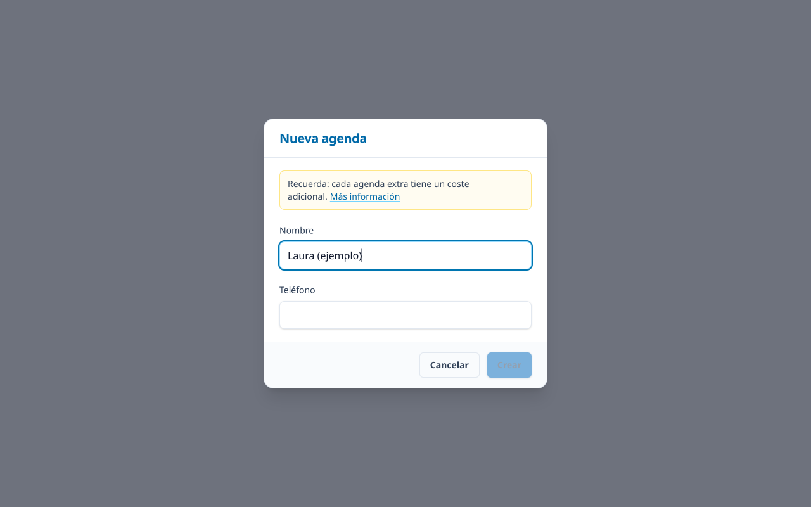
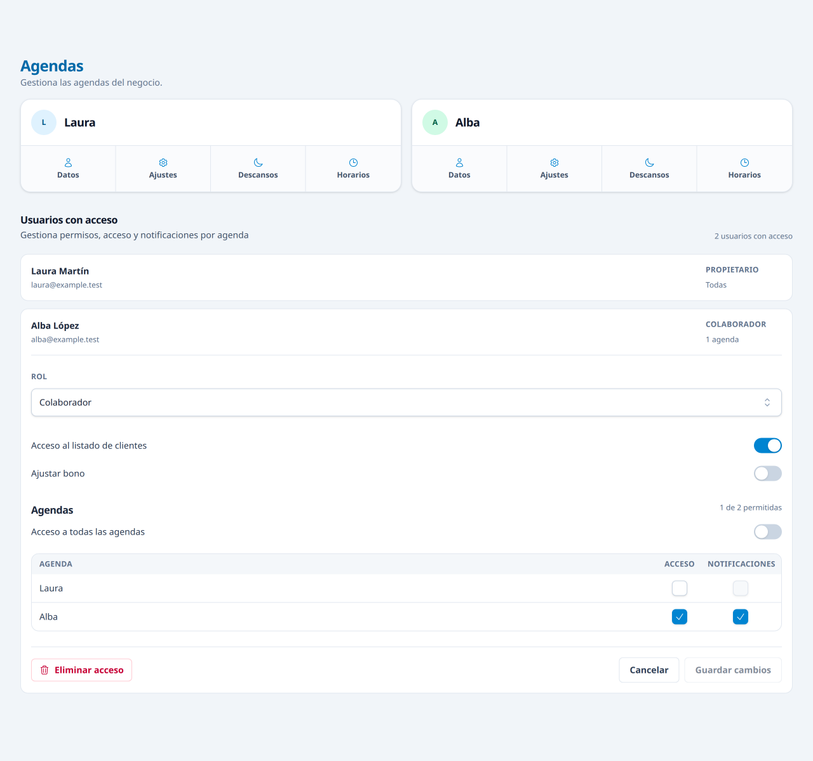
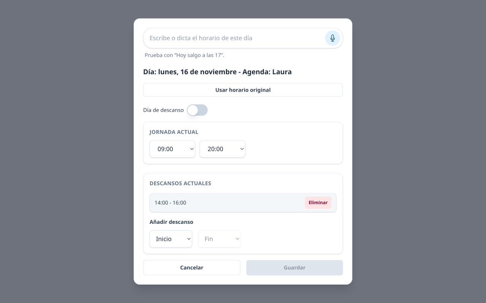
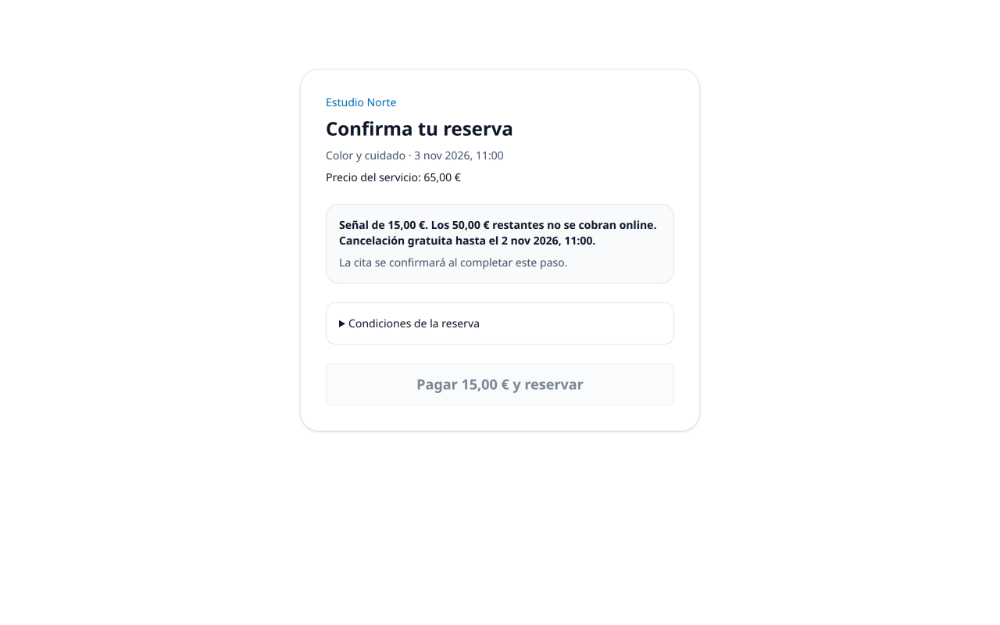

# Pantallas comentadas: agendas, horarios y pagos

Estas imágenes muestran pantallas de Apúntalo con datos ficticios. Los nombres, fechas e importes son ejemplos; no describen tu cuenta. Las explicaciones junto a cada imagen indican dónde mirar y qué significa cada control.

## Crear una agenda

Desde **Agendas > Nueva agenda**, revisa los siguientes elementos:

1. **Aviso de coste adicional**, debajo del título. Crear otra agenda puede cambiar la suscripción; compartir una agenda existente es otra tarea.
2. **Nombre** y **Teléfono**, en el centro del formulario. Introduce los datos de la agenda que vas a crear.
3. **Crear** y **Cancelar**, al pie. El nombre es necesario para crear la agenda. En móvil, los botones se presentan uno encima del otro.

[Ver la misma pantalla en móvil](../imagenes/agenda-mobile.png).

Continúa con [incorporar a un profesional](../19-recorridos/incorporar-profesional.md), que distingue crear agenda, dar acceso y preparar horarios y servicios.

## Revisar el acceso de otra persona

Como propietario, abre **Agendas > Usuarios con acceso** y pulsa el nombre de la persona. La imagen muestra una colaboradora ficticia que ya ha aceptado su acceso.

1. **Rol** indica el tipo de acceso concedido. Colaborador, administrador y propietario no tienen las mismas facultades.
2. **Acceso al listado de clientes** y **Ajustar bono** son permisos distintos en el ejemplo.
3. **Acceso a todas las agendas** permite distinguir acceso general y selección de agendas concretas.
4. En la tabla, **Acceso** y **Notificaciones** tienen casillas separadas. En el ejemplo, Alba solo accede a su agenda y recibe sus notificaciones.
5. **Guardar cambios** aplica la edición. **Eliminar acceso** retira el acceso de la persona; no es el botón para eliminar una agenda.

[Ver los permisos desplegados en móvil](../imagenes/permisos-mobile.png).

Para enviar la invitación inicial, sigue [incorporar a un profesional](../19-recorridos/incorporar-profesional.md). Esta imagen corresponde a la revisión de un acceso existente.

## Cambiar el horario de un día

Comprueba primero la fecha y la agenda indicadas en el título. Esta pantalla afecta al día elegido.

1. **Usar horario original**, debajo del título, permite recuperar el horario habitual cuando el día tiene un cambio manual.
2. **Día de descanso** permite cerrar ese día.
3. **Jornada actual** muestra las horas de inicio y fin. En el ejemplo, la jornada va de 09:00 a 20:00.
4. **Descansos actuales** muestra el intervalo sin trabajo, de 14:00 a 16:00 en el ejemplo. Usa **Añadir descanso** para introducir otro intervalo válido.
5. **Guardar**, al pie, queda desactivado mientras no haya un cambio que guardar. Comprueba el resultado en la agenda después de guardar.

[Ver la misma pantalla en móvil](../imagenes/horarios-mobile.png).

Cerrar el día no debe confundirse con cancelar sus citas. Consulta [vacaciones y horario de verano](../19-recorridos/vacaciones-y-horario-verano.md) para revisar las citas existentes y elegir entre un cambio puntual y uno por periodo.

## Confirmar una reserva con señal

Esta es la pantalla del cliente antes de completar una reserva con pago anticipado.

1. **Precio del servicio**, debajo del nombre y la fecha: 65 € en el ejemplo.
2. **Condiciones de la señal**, en el recuadro: se solicitan 15 € y quedan 50 € que no se cobran online en este paso. También aparece el plazo de cancelación gratuita del ejemplo.
3. **Condiciones de la reserva** permite consultar los detalles.
4. **Pagar 15,00 € y reservar** identifica la cantidad solicitada en ese paso. La imagen muestra una reserva todavía sin completar; no es un recibo ni una confirmación de pago.

[Ver la misma pantalla en móvil](../imagenes/pago-mobile.png).

Una garantía con tarjeta es una modalidad distinta: guardar la tarjeta no significa cobrar una señal. Consulta [cobros a clientes](../13-cobros-a-clientes/cobros.md) y [qué revisar cuando un cliente dice que ha pagado](../19-recorridos/cliente-dice-que-ha-pagado.md).
