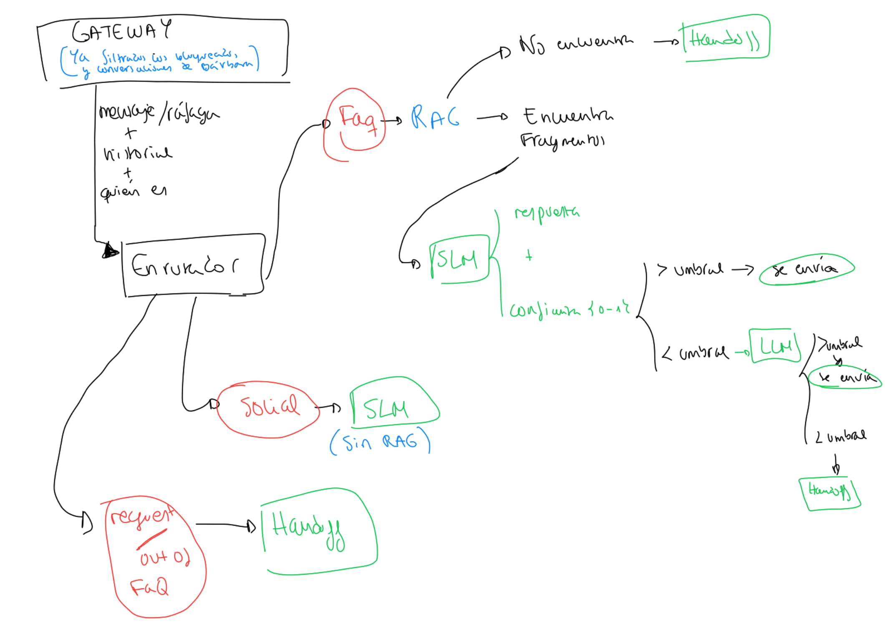

# Enrutador: diseño y alternativas

## 1. Qué hace el enrutador

Cuando llega un mensaje, el enrutador decide quién lo contesta: el modelo pequeño (SLM), el
grande (LLM) o Bárbara. La idea es usar el SLM siempre que baste, para gastar menos sin perder
calidad.

Recibe del gateway el mensaje (o varios seguidos, una ráfaga), los últimos mensajes de la
conversación y quién es la persona. El gateway ya ha quitado los mensajes de personas bloqueadas
y las conversaciones que lleva Bárbara.

Es la pieza que nos ahorra dinero: no llama a ningún modelo cuando no hace falta y usa el SLM en
vez del LLM siempre que baste, sin que baje la calidad (H1 y H2).

## 2. El flujo

1. Unas reglas resuelven lo evidente ("gracias", un emoji, un mensaje vacío).
2. Si no, un clasificador decide la intención: `faq`, `social`, `request` u `out_of_faq`.
3. Si es `faq`, el RAG busca en las guías los fragmentos que responden.
4. El SLM responde con esos fragmentos y dice lo seguro que está (de 0 a 1).
5. Si su confianza pasa el umbral, se envía. Si no, responde el LLM.

Un mensaje acaba en Bárbara en tres casos:

- No es una pregunta de las guías (`request` u `out_of_faq`).
- El RAG no encuentra nada fiable.
- El LLM tampoco está seguro de su respuesta.

Ejemplo: "¿Cuánto cuesta el bono de 10 clases?" → `faq` → el RAG encuentra la sección de precios
→ el SLM responde con confianza 0,9 → se envía. No se ha usado el LLM.

Ejemplo que acaba en el LLM: "Si ya tengo el bono, ¿puedo pagar el curso de verano en dos
plazos?" → `faq` → el RAG encuentra las secciones de pagos y del curso de verano → el SLM duda
porque tiene que juntar las dos (confianza 0,4) → responde el LLM con los mismos fragmentos
(confianza 0,85) → se envía.

Ejemplo que acaba en Bárbara: "Quiero que me devolváis el dinero de la clase de ayer" →
`request` → Bárbara. No se llama a ningún modelo.

## 3. Qué está decidido

| Pieza | Decisión | Por qué |
|---|---|---|
| Reglas | Lista corta para lo evidente | No necesita un modelo y se entiende sola |
| Intenciones | `faq`, `social`, `request`, `out_of_faq` | `social` salió en el estudio del RAG (ADR 0002) |
| SLM o LLM | Cascada: primero el SLM, el LLM solo si duda | El SLM es local, así que probarlo primero cuesta poco, y la latencia no es prioritaria |
| Social | SLM con otro prompt, sin RAG y sin dar datos | No hay nada que buscar |
| Si falla e5 | Handoff | Sin e5 tampoco funciona el RAG |
| Código | Propio, con piezas intercambiables | Fácil de mantener y permite probar las opciones del apartado 5 |

## 4. Las piezas

### 4.1 Reglas

| Mensaje | Qué pasa |
|---|---|
| Solo emojis o stickers | No se contesta |
| "gracias", "ok", "vale"… (lista cerrada) | Respuesta con plantilla |
| Vacío o solo adjuntos | Bárbara |

Las reglas solo saltan si el mensaje entero es eso. "Gracias, ¿y cuánto cuesta?" va al
clasificador.

### 4.2 Clasificador de intención

Usa el vector de e5 que ya calcula el RAG, así el texto se procesa una sola vez. Se compararán
cuatro opciones, de más simple a más compleja:

- **A:** busca el ejemplo de entrenamiento más parecido y copia su intención.
- **B:** una regresión logística sobre el vector de e5.
- **C:** SetFit, que ajusta e5 con pocos ejemplos.
- **D:** ajustar e5 entero.

Si el clasificador no está seguro, el mensaje pasa directamente al LLM, que responde o lo deriva
a Bárbara. Más adelante se puede probar a usar un LLM solo como árbitro de la intención.

### 4.3 SLM o LLM: la cascada

El SLM responde y da su confianza. Por encima del umbral se envía; por debajo, responde el LLM
con los mismos fragmentos. Si el LLM tampoco llega a su umbral, el mensaje va a Bárbara. Los dos
umbrales son distintos.

El problema es que los modelos pequeños a veces dicen estar seguros cuando se equivocan. Por eso
se probarán varias formas de sacar la confianza:

- Que la diga el propio SLM en su respuesta.
- La probabilidad de las palabras que ha generado (se puede leer porque es local).
- Preguntarle después "¿la respuesta está en los fragmentos?" y usar la probabilidad del sí.
- Un clasificador que, antes de responder, estima si el SLM bastará.

La respuesta que sale de la cascada pasa después por el gateway de salida, que no es parte del
enrutador (ver `database.md`, `output_result`).

## 5. Cómo se elige entre las opciones

Todas las opciones se prueban con los mismos mensajes, y las respuestas las juzga el mismo LLM,
con una muestra revisada a mano. Entre las que no sean claramente peores que la mejor, nos
quedamos con la más simple de mantener y la más barata.

| Qué se elige | Opciones | Cómo se mide |
|---|---|---|
| Clasificador | A, B, C, D | Aciertos de intención |
| Confianza del SLM | Las cuatro de 4.3 | Cuántos mensajes van al LLM sin perder calidad |
| Umbrales | — | Curvas de errores frente a mensajes escalados |
| SLM | Qwen, Gemma, Ministral, Nemotron | Calidad en español y licencia |

Siempre se compara con dos casos de referencia: usar siempre el SLM y usar siempre el LLM.

Para juzgar hacen falta las respuestas completas de los dos modelos. Nos apoyamos en la
propuesta de guardar prompts y respuestas durante la puesta a punto (PR #17).

## 6. Descartado

- **Un LLM local como clasificador:** más lento y más difícil de mantener que B.
- **Embeddings por API:** ya tenemos e5 en local para el RAG.
- **Etiquetar a mano la dificultad de cada pregunta:** es subjetivo y no mide el ahorro.

## 7. Pendiente

- Export de conversaciones de Bárbara, anonimizado. Sin él no se puede entrenar ni medir nada.
- Qué LLM usamos (también hace de juez).
- Gestor de dependencias (scikit-learn, SetFit), junto con la PR #17.
- Cuándo se usa `deny`.
- Esquema: añadir `social` y decidir dónde se guarda la confianza del SLM.
- Cómo usar el historial en preguntas como "¿y el de inglés?".
- Con la cascada, el enrutador ya no decide de antemano entre SLM y LLM: `tier`, `complexity` y
  `decided_by = arbiter` de `RouteDecision` cambian de significado. Hay que actualizar
  `gateway.md` (sección 7) y `database.md`.
