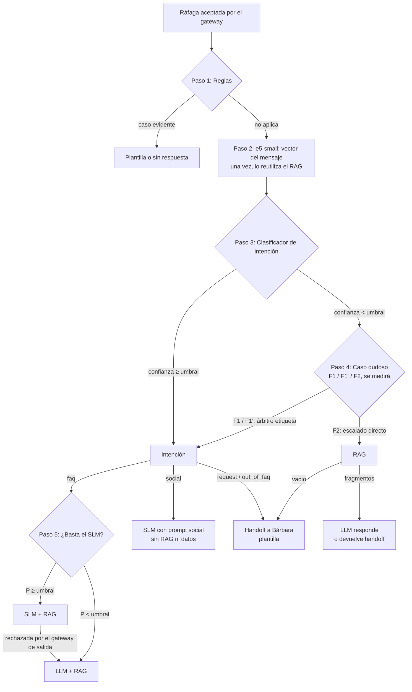

# Alternativas de diseño para el enrutador

> **Estado:** borrador para discutir con el equipo. No implementa nada.
> **Alcance:** qué piezas tiene el enrutador (`modules/router/`), qué opciones se han considerado
> para cada una, con cuáles nos quedamos, cuáles se medirán y cuáles se descartan de entrada y por qué.
> **Depende de:** la PR #18 (`docs/decisions/0002-rag-busqueda-hibrida.md`), que fija el orden
> gateway → enrutador → RAG y el modelo de *embeddings* `multilingual-e5-small`.

Leyenda de estados: ✅ propuesta o ya decidida · 🧪 se medirá antes de decidir · ❌ descartada de entrada.

## 1. Contexto

### 1.1 Qué decide el enrutador y qué no

El enrutador recibe un `RouteRequest` del gateway (`docs/architecture/gateway.md`, sección 7) y
devuelve un `RouteDecision`:

| Decide | No decide |
|---|---|
| La **intención** del mensaje: `faq`, `social`, `request`, `out_of_faq` | Si la respuesta está en la ayuda: eso es del **RAG**, que se abstiene con el coseno de e5-small (ADR 0002) |
| La **acción**: responder, derivar (handoff), denegar | El texto de la respuesta |
| El **nivel de modelo** que responde: `slm`, `llm` o `none` | Si la respuesta generada es válida: eso es del gateway de salida |
| La temática y la complejidad (para métricas) | |

### 1.2 Restricciones

- **Nunca inventa** (`AGENTS.md`): la información solo sale de las guías de `data/faqs/ayuda/`.
- **RGPD:** los mensajes de clientes no deben salir a terceros sin necesidad. Lo que pueda ser local, local.
- **CPU:** el servidor puede no tener GPU.
- **Latencia de la decisión < 20 ms** en la fase de clasificador (hipótesis H3 del TFG). El árbitro se mide aparte.
- **Trazabilidad:** cada fase deja una fila en `routing_decisions` con sus probabilidades (`scores`),
  para poder simular otros umbrales sin volver a ejecutar nada (`database.md`, 6.13).

### 1.3 Ya decidido (no se reabre aquí)

- **Arquitectura híbrida** reglas → clasificador → escalado si duda (decisión del 2026-11-12).
  Patrón de RouteLLM (umbral sobre la puntuación de un clasificador) y de FrugalGPT (de lo barato a lo caro).
- **El RAG va después del enrutador** y es obligatorio en `faq`. Se descarta el RAG agéntico (ADR 0002).
- **Intención `social`** para saludos, agradecimientos y emojis (ADR 0002).
- **`multilingual-e5-small`** como modelo de *embeddings* del RAG (ADR 0002).

## 2. Propuesta en una imagen



El mismo diagrama en imagen: `enrutador-flujo.png`, capturado del bloque anterior renderizado con Mermaid 11.4.1.
Si se cambia el bloque, hay que regenerar la imagen.

**Un modelo con tres salidas.** El mensaje pasa una sola vez por e5-small y, sobre ese vector,
el clasificador da tres salidas:

```
mensaje → e5-small (un vector) → ┬─ intención:  faq 0,94 · request 0,03 · …
                                 ├─ dificultad: P(el SLM basta) = 0,85
                                 └─ tema:       "bonos y precios"
```

| Salida | Qué decide |
|---|---|
| **Intención** | La acción (`faq` → responder; `request` / `out_of_faq` → handoff; `social` → prompt social). Si su confianza es baja, el mensaje va al caso dudoso |
| **Dificultad** | Solo en `faq`: SLM o LLM, según el umbral |
| **Tema** | Por ahora nada: se registra para las métricas (la temática aprobada del TFG pide analizarlo) |

El coste y la latencia no son salidas del modelo: se controlan con el umbral de dificultad.

Dos ejemplos:

| Mensaje | Intención | Nivel | Resultado |
|---|---|---|---|
| "¿Cuánto cuesta el bono de 10 clases?" | Clasificador: `faq` 0,94 → decide él | P(el SLM basta) = 0,85 → `slm` | SLM responde con el RAG. Sin ninguna llamada de pago para decidir |
| "oye lo del otro día al final cómo quedó" | Clasificador: `faq` 0,38 → duda → se escala; el árbitro dice `request` | No aplica | Handoff con plantilla |

## 3. Las piezas, una a una

### 3.1 Reglas (`decided_by = rule`) ✅

Una lista corta de comprobaciones fijas, sobre el texto en minúsculas y sin tildes:

| Caso | Decisión |
|---|---|
| Solo emojis o stickers | `social`, sin respuesta |
| "gracias", "ok", "vale"… (lista cerrada) | `social`, plantilla |
| Vacío o solo adjuntos | Handoff |

**Por qué:** lo evidente no necesita un modelo, sale gratis y se explica solo. Pocas reglas, porque
cada una es mantenimiento y casos que se escapan.

**Pendiente:** `deny` no sale de las reglas hasta que tenga criterio.

### 3.2 Modelo de *embeddings*: e5-small, compartido con el RAG ✅

El texto se convierte en vector **una sola vez** y lo usan el enrutador y el RAG.

| Opción | Estado | Motivo |
|---|---|---|
| `multilingual-e5-small`, compartido | ✅ | Ya elegido en el ADR 0002. Local, multilingüe y ~13 ms por búsqueda en CPU (casi todo es codificar). Compartirlo es lo que hace creíble H3 |
| `multilingual-e5-base` / XLM-R base | ❌ | Más del doble de latencia. En el RAG, e5-base no mejoró de forma significativa a e5-small |
| `paraphrase-multilingual-MiniLM-L12-v2` | ❌ | Por debajo de BM25 en la prueba del RAG |
| *Embeddings* por API | ❌ | Saca los mensajes a un tercero (RGPD) y añade latencia de red |

### 3.3 Tipo de clasificador 🧪

Las cuatro candidatas parten de e5-small y dan las mismas salidas (intención y dificultad; el tema
se saca aparte, sin entrenar). **No son cuatro pasos**: son cuatro formas de construir la misma
pieza. Se construyen todas, se comparan con los mismos datos y en producción va la que elija la
regla de la sección 5.1.

| | Cómo funciona | Qué aporta | Coste |
|---|---|---|---|
| **A. Ejemplo más parecido** | Se compara el vector con ejemplos etiquetados y gana la clase del más parecido (lo que hace la librería semantic-router) | Línea base sin entrenar | Sin entrenamiento; comparte el vector con el RAG |
| **B. e5-small congelado + regresión logística** | e5-small no cambia; encima, un modelo lineal aprende las clases | Lo más barato que aprende. Probabilidades fáciles de calibrar | Comparte el vector con el RAG |
| **C. SetFit** | Se ajusta e5-small con pares de frases ("misma intención / distinta") y luego se pone una cabeza de clasificación | Diseñado para pocos datos (Tunstall et al., 2022) | Segunda pasada por el modelo: ~2 × la latencia de B |
| **D. e5-small ajustado entero** | Ajuste fino clásico tipo BERT con una capa de clasificación | Mismo tipo de router que el router BERT de RouteLLM: comparación directa con la literatura | Como C |

**Por qué las cuatro con el mismo modelo base:** así la única diferencia es el método de
entrenamiento y la comparación es justa. De A a D la complejidad crece; la pregunta es en qué
punto deja de compensar.

**Ojo con la latencia de C y D:** un e5-small ajustado ya no sirve al RAG, que necesita el original.
Serían dos pasadas (~10 ms cada una en CPU), justo en el límite de H3. Hay que medirlo.

Descartadas de entrada:

| Opción | Motivo |
|---|---|
| Ajuste fino de *encoders* grandes (DistilBERT multilingüe, XLM-R base) | Con ~500 ejemplos tienden a sobreajustar, y la latencia pone en riesgo H3. D ya cubre el ajuste fino completo con un modelo del mismo tamaño |
| Clasificación *zero-shot* con NLI | No necesita datos, pero hace una pasada por clase (lento) y rinde peor en español |
| LLM local como clasificador (p. ej. Arch-Router 1.5B) | Cientos de ms en CPU: incumple H3. Licencia propia de Katanemo |

### 3.4 Acción y temática ✅

- **La acción sale de la intención**: `faq` y `social` → responder; `request` y `out_of_faq` → handoff.
  Es un clasificador menos que entrenar y que se pueda equivocar.
- **Temática:** prioridad baja. Se obtiene por parecido del vector con las categorías de las guías,
  sin entrenar. Solo sirve para métricas.

### 3.5 Nivel de modelo: P(el SLM basta) ✅ propuesta

Solo se aplica a `faq` (`social` va siempre al SLM y el resto no usa modelo).

**Cómo se etiqueta:** cada pregunta de entrenamiento se responde con el SLM y con el LLM, con los
mismos fragmentos del RAG. Un juez (un LLM, con revisión humana de una muestra) decide si la
respuesta del SLM basta. El clasificador aprende P(el SLM basta), con las mismas variantes A–D.

**Cómo se decide:** el umbral sobre esa probabilidad es el mando coste–calidad. Si se sube, va más
tráfico al LLM; si se baja, se ahorra más. Si duda, va al LLM: equivocarse hacia el LLM cuesta
dinero, equivocarse hacia el SLM cuesta calidad.

**Consecuencia en el esquema:** `complexity = 1 − P(el SLM basta)`, así la columna tiene un significado medible.

| Opción | Estado | Motivo |
|---|---|---|
| P(el SLM basta), aprendida de la diferencia de calidad | ✅ | Mide justo lo que plantea H2: ahorro sin perder calidad. Es el método de Hybrid LLM (Ding et al., ICLR 2024) y equivale a las etiquetas de preferencia de RouteLLM |
| Complejidad 0–1 etiquetada a mano | ❌ | Subjetiva y sin relación directa con el ahorro |
| Cascada: siempre SLM y, si no vale, LLM (AutoMix) | ❌ como diseño, 🧪 como línea base | Siempre se paga la generación del SLM y necesita un verificador fiable. Ya existe una versión limitada: si el gateway de salida rechaza la respuesta del SLM, se repite con el LLM |

### 3.6 Confianza y umbrales ✅

- Probabilidades **calibradas con *temperature scaling*** (Guo et al., 2017): un solo parámetro y no
  cambia la clase elegida. Sin calibrar, una confianza de 0,9 no significa un 90 % de acierto.
- Los dos umbrales (intención y nivel) se eligen en validación con curvas: "% escalado frente a
  error" y "% al LLM frente a calidad". Objetivo orientativo de escalado: 10–20 %.
- Como `routing_decisions` guarda `scores` y `threshold`, cualquier umbral se puede simular offline.
- **Predicción conformal:** trabajo futuro. Su uso para enrutar intenciones aún no está asentado.

### 3.7 Caso dudoso: qué pasa cuando el clasificador de intención duda 🧪

Tres flujos candidatos:

| | Cómo | ✅ | ❌ |
|---|---|---|---|
| **F1. Árbitro LLM que solo etiqueta** | Un LLM por API devuelve la intención (JSON con valores cerrados, temperatura 0, definiciones y ejemplos). Después se sigue el flujo normal | Seguro: un `request` se deriva sin que ningún modelo intente responder. Cada decisión queda separada y medible | Hasta dos llamadas en un `faq` dudoso (etiquetar y responder). Un componente más |
| **F1'. Árbitro SLM que solo etiqueta** | Igual que F1, con el SLM local | Gratis y local | El árbitro solo ve los mensajes difíciles, donde un modelo pequeño falla más, y es probable que dude en los mismos que el clasificador. 1–3 s en CPU |
| **F2. Escalado directo** | Primero el RAG; si devuelve vacío, handoff sin llamar a ningún modelo. Si hay fragmentos, el LLM que responde devuelve `{intent, action: answer \| handoff, texto}` | Una llamada y un componente menos. Más cerca de RouteLLM (si duda, al modelo fuerte) | Si el mensaje acaba en handoff, se ha pagado una llamada grande. Riesgo de que el LLM "ayude" con algo que debía ir a Bárbara. La intención se mezcla con la respuesta |

**No está claro de antemano cuál gasta menos:** F2 ahorra la llamada pequeña cuando el dudoso es
`faq`, pero paga una grande cuando acaba en handoff. Depende de la proporción, que solo se sabe con datos.

**Se medirá:** acierto en los mensajes dudosos, coste y latencia por mensaje dudoso, y **% de
`request` que se cuelan como respuesta** (el riesgo de F2).

**Impacto en el esquema si gana F2:** `decided_by = arbiter` y `purpose = routing` dejarían de
describir lo que pasa. Habría que decidir cómo registrar una intención que sale de la llamada de respuesta.

### 3.8 Fallos ✅

| Fallo | Qué se hace | Por qué |
|---|---|---|
| e5-small no carga o falla | Handoff | Sin e5 tampoco hay RAG ni abstención (degradación segura, ADR 0002). Escalar al LLM no serviría |
| Falla el clasificador, pero e5 funciona (p. ej., no carga el archivo del modelo) | Handoff (alternativa: escalar como en el caso dudoso) | Caso raro; se decide al implementar |
| El árbitro no responde | Handoff | Escalón seguro |
| El gateway de salida rechaza la respuesta del SLM | Se repite con el LLM y los mismos fragmentos | Ya decidido |

### 3.9 Modelos que responden (SLM y LLM) 🧪

Se eligen con la evaluación del capítulo 8 del TFG y tendrán su propia decisión.

- **Candidatos a SLM local (3B–9B):** Qwen3.5 4B/9B, Gemma 4 E4B, Ministral 3 3B/8B y Nemotron 3 Nano 4B.
  Las fuentes encontradas son secundarias y no miden el español: hay que confirmar versiones y
  licencias en Hugging Face y evaluarlos con nuestras preguntas.
- **Motor para ejecutarlos** (llama.cpp, Ollama…): otra dependencia por decidir.
- **LLM por API:** por decidir con el equipo. El árbitro (F1) debería ser del mismo proveedor para
  no añadir otro tercero que trate mensajes de clientes.

### 3.10 Implementación: código propio ✅

| Opción | Estado | Motivo |
|---|---|---|
| Código propio en `modules/router/` | ✅ | Coherente con el ADR 0002; explicable en el TFG |
| RouteLLM (librería) | ❌ como librería, referencia y línea base | Entrenado con Chatbot Arena, en inglés, con preferencias generales (GPT-4 frente a Mixtral). No clasifica intenciones |
| semantic-router | ❌ | La opción A son unas pocas líneas; no compensa la dependencia |
| LiteLLM | ❌ | Es un proxy que reparte carga entre proveedores, no un enrutador semántico |

## 4. Datos de entrenamiento y evaluación

- **Objetivo:** ≥ 500 mensajes etiquetados (intención y, en `faq`, si basta el SLM).
- **Fuentes:**
  - Las 104 preguntas de `data/faqs/evaluacion-ayuda/` (dan `faq` / `out_of_faq` casi directamente).
  - Conversaciones reales de Bárbara, anonimizadas y fuera de git (`storage/`).
  - Paráfrasis sintéticas en estilo DM (cortas, informales, con faltas), generadas con un LLM.
- **Etiquetado:** el LLM propone y una persona revisa. Se mide el acuerdo (kappa de Cohen) en una muestra.
- **Test solo con mensajes reales.** Con sintéticos, las cifras salen optimistas, como ya avisa el ADR 0002.
- Las 104 preguntas del RAG **no se indexan nunca**; usarlas para entrenar el enrutador no toca el índice,
  pero el test del enrutador y el del RAG no deben compartir preguntas.

## 5. Cómo se evaluará

**Líneas base estáticas:** siempre SLM, siempre LLM, aleatorio con el mismo % de LLM (como RouteLLM)
y cascada.

| Pregunta | Comparación | Métricas |
|---|---|---|
| ¿Qué tipo de clasificador? | A, B, C, D | F1 macro, calibración (ECE), % escalado, p95 de latencia |
| ¿Qué hacer con los dudosos? | F1, F1', F2 | Acierto en dudosos, coste y latencia por dudoso, % de `request` colados |
| ¿Cuánto se ahorra? (H1, H2) | Enrutador frente a las líneas base | % de llamadas al LLM, coste por mensaje, calidad según el juez |
| ¿Es despreciable la decisión? (H3) | Fase de clasificador | p95 de `routing_decisions.latency_ms` con `phase = classifier` |

Todo sale de `routing_decisions`, `processing_runs` y `model_calls`, sin tablas nuevas.

### 5.1 Cómo se elige la opción final

Las reglas se fijan **antes** de medir, para que la elección no dependa de cómo salgan los números.
Los valores marcados como propuesta (2 %, 5 puntos, 20 %…) se acuerdan con el equipo en esta PR.

| Decisión | Regla | Apuesta previa |
|---|---|---|
| **Tipo de clasificador** (A, B, C, D) | Se elige **el más simple** que cumpla las dos condiciones: (1) su F1 macro de intención **no es significativamente peor** que el del mejor (*bootstrap* pregunta a pregunta, IC 95 %, como en el ADR 0002) y (2) **p95 de la fase de clasificador < 20 ms** (H3). Orden de simplicidad: A < B < C < D | **B**: comparte el vector con el RAG, no hay modelo propio que mantener y con ~500 ejemplos suele bastar |
| **Umbral de intención** | El que deja el **error entre los no escalados ≤ 5 %** (propuesta) con el menor % escalado. Si para eso hay que escalar más del 20 %, se revisan los datos o el clasificador antes de aceptarlo | 10–20 % escalado |
| **Caso dudoso** (F1, F1', F2) | **F2** si el % de `request` que se cuelan como respuesta es **≤ 2 %** (propuesta) **y** su coste por mensaje dudoso es menor que el de F1. Si no, **F1**. **F1'** sustituye a F1 si su acierto en los dudosos está a **≤ 5 puntos** del de F1 (propuesta) y su p95 es aceptable | **F1** |
| **Umbral de dificultad** (SLM o LLM) | El que **minimiza el coste** con una **pérdida de calidad < 10 %** frente a "siempre LLM", medida con el juez. Es la condición de H2 | Por medir |
| **SLM** | El de mejor calidad en español según el juez, entre los que tengan licencia permisiva y una latencia de generación aceptable en CPU (tope a fijar con el equipo) | Por medir |
| **LLM** | Lo decide el equipo (proveedor), con la misma evaluación | — |

Si ninguna opción de una fila cumple su regla, la decisión vuelve al equipo con los datos; no se
relaja la regla a posteriori sin dejarlo escrito.

## 6. Consecuencias en el esquema

- **`social`** no está en los `CHECK` de `intent` (pendiente del ADR 0002).
- **Dos salidas en una fase:** `routing_decisions` tiene una fila por fase y un único `scores`.
  Propuesta: guardar los dos en el mismo JSON, p. ej.
  `{"intent": {"faq": 0.94, "request": 0.03, …}, "slm_ok": 0.85}`. El campo `confidence` y el `threshold` se
  refieren a la intención; el umbral del nivel iría en `config_hash` o en el propio JSON. A decidir.
- **F2**, si gana, cambia el significado de `arbiter` (sección 3.7).
- **`router_version`** tiene que identificar la variante (A–D), el modelo base y la versión del entrenamiento.

## 7. Decisiones que se piden al equipo

1. **Dependencias:** scikit-learn (B), SetFit (C) y `transformers` (D), además de PyTorch, que ya entra con el ADR 0002.
   Conviene decidir el gestor de dependencias de una vez (pendiente en la 0001).
2. **Caso dudoso:** ¿se acepta medir F1, F1' y F2 antes de fijarlo, aunque la tabla del esquema asuma F1?
3. **Criterio de `deny`.**
4. **¿`request` sigue siendo también una acción** (pedir datos al cliente), además de una intención?
   Hoy el nombre se usa para las dos cosas.
5. **Proveedor del LLM**, que fija también el árbitro.
6. **Export de conversaciones de Bárbara**, del que dependen el entrenamiento y el test.
7. **Valores de las reglas de elección** (sección 5.1): 2 %, 5 puntos, 5 % de error y el tope de latencia del SLM.

## Referencias

- Ong et al., *RouteLLM: Learning to Route LLMs with Preference Data* — https://lmsys.org/blog/2024-07-01-routellm/ · https://github.com/lm-sys/RouteLLM
- Chen et al., *FrugalGPT* (2023).
- Ding et al., *Hybrid LLM: Cost-Efficient and Quality-Aware Query Routing*, ICLR 2024 — https://arxiv.org/abs/2404.14618
- Aggarwal et al., *AutoMix: Automatically Mixing Language Models*, NeurIPS 2024 — https://arxiv.org/abs/2310.12963
- Tunstall et al., *Efficient Few-Shot Learning Without Prompts* (SetFit), 2022 — https://arxiv.org/abs/2209.11055
- Guo et al., *On Calibration of Modern Neural Networks*, ICML 2017 — https://proceedings.mlr.press/v70/guo17a.html
- Tran et al., *Arch-Router: Aligning LLM Routing with Human Preferences*, 2025 — https://arxiv.org/abs/2506.16655
- semantic-router — https://github.com/aurelio-labs/semantic-router
- Wang et al., *Multilingual E5 Text Embeddings*, 2024 — https://arxiv.org/abs/2402.05672
