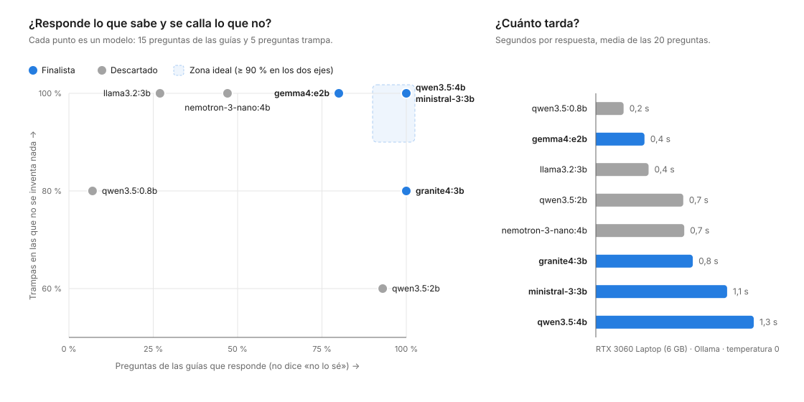

# Criba de SLM

## Objetivo

Reducir los 8 SLM candidatos a 3-4 finalistas antes del benchmark completo. Se descarta lo que
claramente no sirve: no responde en español, no sigue el formato, se inventa respuestas a preguntas
que no están en las guías o es demasiado lento.

## Cómo se hizo

- 20 preguntas: 15 de `data/faqs/evaluacion-ayuda/` repartidas por temas y 5 trampa que no aparecen
  en ninguna guía (Holded, Android TV, Verifactu, Bizum, Shopify). El RAG les devuelve fragmentos
  parecidos, así que el modelo tiene que darse cuenta de que no responden.
- Los mismos 3 fragmentos del RAG (BM25) para todos los modelos.
- Ollama, temperatura 0, modo "pensar" desactivado, `num_ctx` 8192.
- Se le pide que diga `NO_LO_SE` si los fragmentos no responden y que acabe con `CONFIANZA: 0-1`.
- Las respuestas se puntúan a mano en `respuestas.md` (0, 1 o 2).

Máquina, versiones exactas y tabla completa: `resumen.md`.

## Resultados (2026-11-26)

Figura generada con `python -m modules.router.benchmark.grafico_criba`. Tabla completa en
`resumen.md` y todas las respuestas en `respuestas.md`. Todos responden en español y devuelven logprobs, y todos caben al
100 % en la GPU de 6 GB.

| Modelo | Se abstiene en preguntas de las guías (mal) | Trampas en las que se abstiene (bien) | Lo que se ve al leer las respuestas |
|---|---:|---:|---|
| qwen3.5:0.8b | 14/15 | 4/5 | Casi siempre dice `NO_LO_SE`. En Bizum dice "sí" y "NO_LO_SE" a la vez |
| qwen3.5:2b | 1/15 | 3/5 | Se inventa lo de Bizum con confianza 0,95. Falla el cálculo de AYUDA-069 |
| **qwen3.5:4b** | **0/15** | **5/5** | Respuestas correctas y concretas. El más lento (1,3 s) |
| **gemma4:e2b** | 3/15 | **5/5** | El más rápido (0,4 s). Falla AYUDA-069 ("60 €") con confianza 1. Su confianza no tiene sentido: pone 1,0 al decir `NO_LO_SE` |
| **ministral-3:3b** | **0/15** | **5/5** | Correcto, algo largo y con mucho Markdown. Pone confianza 0 a respuestas correctas |
| nemotron-3-nano:4b | 8/15 | 5/5 | Se abstiene en la mitad de las preguntas que sí tienen respuesta. Respuestas raras ("NO_LA_CANCELAN_SOLAS") |
| llama3.2:3b | 11/15 | 5/5 | No sigue el formato (1/20) y casi nunca responde |
| **granite4:3b** | **0/15** | 4/5 | Respuestas cortas y correctas. Se inventa lo de Bizum, aunque con confianza baja (0,3) |

AYUDA-069 (60 € de servicio, 15 € de señal online y 45 € en efectivo: lo cobrado online son 15 €)
separa bien a los modelos: aciertan qwen3.5:4b, ministral-3:3b, granite4:3b y nemotron; fallan
qwen3.5:2b y gemma4:e2b.

**La confianza que dicen los modelos no es fiable.** Gemma pone 1,0 a una respuesta mal y a
abstenciones. Ministral pone 0 a respuestas bien. Por eso el benchmark completo compara las cuatro
formas de medir la confianza (`enrutador-alternativas.md`, 4.3) y no se fía solo de lo que dice el
modelo.

Primera ejecución descartada: el script contaba como respuesta frases como "No hay información
sobre Verifactu", no leía `**CONFIANZA:**` con negrita y dejaba cargado el modelo anterior
(qwen3.5:2b salió al 12 % de GPU y 3,2 s por respuesta). Se corrigió y se repitió.

## Decisión (2026-11-26, aceptada por Dani)

**Finalistas:** qwen3.5:4b, ministral-3:3b, granite4:3b y gemma4:e2b.

- Los tres primeros no se abstienen en ninguna pregunta que tiene respuesta y aciertan el cálculo.
- gemma4:e2b falla más, pero es 3 veces más rápido que qwen3.5:4b. Se mantiene para ver si, con una
  buena medida de confianza, compensa su velocidad.

**Descartados:** qwen3.5:0.8b, llama3.2:3b y nemotron-3-nano:4b, porque no responden lo que sí está
en las guías; y qwen3.5:2b, porque se inventa respuestas con mucha confianza. qwen3.5:2b se puede
recuperar para la curva "tamaño del SLM frente a % de mensajes que van al LLM".

Limitación: son 20 preguntas y la corrección se ha hecho leyendo las respuestas, sin la rúbrica
completa. Basta para descartar lo claramente malo, no para elegir el mejor.

## Observaciones de la prueba del script (2026-11-26)

Con `gemma3:1b`, que no es candidato y se usó solo para probar el script: a "Voy a cerrar por
vacaciones. ¿Se cancelan solas las citas?" respondió "Sí, al cerrar el día, se cancelan las citas"
con `CONFIANZA: 1`. Es falso (la guía dice que hay que gestionarlas aparte). Es un ejemplo del
problema que debe medir el benchmark completo: un SLM seguro de una respuesta equivocada.
