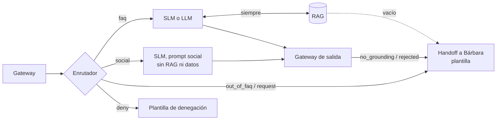

# 0002 · Búsqueda del RAG: híbrida (BM25 + embeddings)

- **Fecha:** 2026-11-19
- **Estado:** propuesta (se acepta al mergear la PR que la añade)

## Contexto

El RAG (`modules/rag/`, PR #16) busca en las guías de ayuda (`data/faqs/ayuda/`, 33 guías
troceadas en 225 secciones) los fragmentos con los que el modelo redacta la respuesta. Hoy busca
**solo por palabras** (BM25 con SQLite FTS5) y su documentación dejaba la búsqueda por
significado "para cuando la evaluación lo justifique". Esta decisión hace esa evaluación: compara
las tres formas de buscar con el mismo conjunto de 104 preguntas y elige una.

Antes de comparar había que cerrar **dónde va el RAG en el flujo**, porque los documentos no
decían lo mismo: el diagrama C2 lo ponía como una opción del enrutador ("elige entre modelos: RAG,
Modelo Apúntalo…") y `database.md` lo ponía después del enrutador.

## El flujo (decidido con todo el equipo)

1. **Gateway → enrutador → SLM, LLM o handoff.** El RAG va **después** del enrutador, dentro del
   camino de respuesta. Se descartó ponerlo antes (como señal para el enrutador): habría que
   cambiar el contrato `RouteRequest` y acoplar los dos módulos.
2. **Cuando la respuesta es de FAQ, el RAG se usa siempre.** No es una herramienta que el modelo
   decida usar o no (lo que se llama *RAG agéntico*): un modelo que decide no buscar contesta de
   memoria, y eso rompe la regla "nunca inventa". SLM y LLM usan la misma búsqueda; si el SLM falla
   y se repite con el LLM, se reutilizan los mismos fragmentos.
3. **Decir "no hay respuesta" es trabajo del RAG**, no del enrutador. Con este orden el enrutador
   ya ha decidido cuando se busca, así que no puede mirar la puntuación. Si el RAG no encuentra
   nada fiable, devuelve vacío y se deriva a Bárbara.
4. **Nueva intención `social`.** Salió durante el estudio: los mensajes sin pregunta ("gracias",
   "👍", "hola") no encajaban en `faq`, `out_of_faq` ni `request`, y todos habrían acabado en la
   bandeja de Bárbara. Lo evidente lo resuelven las reglas (un emoji suelto no se contesta;
   "gracias" recibe una plantilla). El resto lo contesta **el mismo SLM con otro *system prompt***,
   sin RAG y con prohibición de dar datos (precios, fechas, condiciones). El gateway de salida lo
   comprueba igual que cualquier respuesta. No incumple la regla de producto: la **información**
   solo sale de las guías; estas respuestas no llevan información.
5. **`deny` y `request` no pasan por el RAG.** `deny` contesta con una plantilla. `request` (el
   cliente pide que se haga algo: una devolución, una baja) va a Bárbara con la plantilla de
   handoff, porque en el MVP nada ejecuta peticiones.

El diagrama C2 (`docs/architecture/c2.png`) se actualiza en esta misma PR para reflejarlo, y se añade
su fuente editable (`c2.svg`); el PNG se regenera con `rsvg-convert c2.svg -o c2.png`.

## Opciones estudiadas

| Opción | Cómo funciona | ✅ | ❌ |
|---|---|---|---|
| **A. BM25** (lo que hay) | Coincidencia de palabras; pesan más las raras | Librería estándar, 0,2 ms, explicable. Muy buena con términos exactos ("Google Calendar", "bono") | No entiende paráfrasis ni faltas: "me han cobrado dos veces" no encuentra "cobro duplicado". Su puntuación no sirve de umbral (solo es comparable dentro de una búsqueda) |
| **B. Embeddings** | Cada texto es un vector; se compara el significado (coseno) | Entiende sinónimos, paráfrasis y lenguaje informal. El coseno (0–1) sí sirve de umbral | Primera dependencia pesada del proyecto (modelo + PyTorch). Falla más con términos exactos |
| **C. Híbrida con RRF** | Se hacen A y B siempre y se mezclan las dos listas **por posición**: cada fragmento suma `1/(60 + puesto)` en cada lista | Cada método tapa los huecos del otro: gana lo que los dos ponen arriba | Lo peor de B (la dependencia) más lógica de fusión. El resultado es una posición, no una puntuación: para el umbral hay que usar el coseno de B |

Variantes que se miraron y no se probaron:

- **Suma ponderada** (`0,3 × BM25 + 0,7 × coseno`): da una puntuación única, pero BM25 no tiene
  máximo y hay que normalizar y ajustar pesos. RRF no necesita nada de eso.
- **En cascada** (BM25 y, si no convence, embeddings): ahorra poco con 225 fragmentos, y si BM25
  encuentra con seguridad la guía equivocada nunca se llega a los embeddings.
- **Frameworks** (LangChain, LlamaIndex, Haystack): muchas dependencias y abstracciones que ocultan
  lo que pasa. Con código propio son pocas líneas y se puede explicar en la memoria del TFG.

### Modelos de embeddings probados

Locales y multilingües, para no enviar mensajes de clientes a una API externa (RGPD):

- `intfloat/multilingual-e5-small` (118 M parámetros)
- `intfloat/multilingual-e5-base` (278 M)
- `sentence-transformers/paraphrase-multilingual-MiniLM-L12-v2` (118 M)

## Cómo se probó

- Las **104 preguntas** de `data/faqs/evaluacion-ayuda/preguntas.jsonl`, con el troceo, el índice
  BM25 y las métricas de `modules/rag/evaluate.py` (Recall@k y MRR por guía). Así las tres
  opciones se puntúan exactamente igual.
- Cada fragmento se convierte en vector con su título y su texto. e5 usa los prefijos
  `query:` / `passage:` que pide el modelo.
- Híbrida: los 50 primeros fragmentos de cada búsqueda, fusionados con RRF (k = 60).
- Todo en **CPU** (un portátil normal), por si el servidor no tiene GPU.
- Para ver si una diferencia es real o ruido: comparación **pregunta a pregunta** contra BM25 con
  *bootstrap* (5000 remuestreos, intervalo de confianza del 95 %).
- El script del experimento no está en el repo, porque necesita dependencias que el proyecto aún no
  tiene (sentence-transformers y PyTorch). Se ejecutó en un entorno aparte, importando el código de
  `modules/rag/`.

## Resultados

| Opción | Recall@1 | Recall@3 | Recall@5 | MRR | Tiempo por búsqueda |
|---|---:|---:|---:|---:|---:|
| A. BM25 | 0,486 | 0,744 | 0,827 | 0,656 | 0,2 ms |
| B. Embeddings, e5-small | 0,542 | 0,771 | 0,880 | 0,710 | 13 ms |
| **C. Híbrida, BM25 + e5-small** | **0,551** | **0,833** | **0,904** | **0,738** | 13 ms |
| B. Embeddings, e5-base | 0,514 | 0,837 | 0,909 | 0,714 | 29 ms |
| C. Híbrida, BM25 + e5-base | 0,590 | 0,804 | 0,897 | 0,749 | 30 ms |
| B. Embeddings, MiniLM | 0,330 | 0,606 | 0,768 | 0,530 | 10 ms |

Pregunta a pregunta, contra BM25:

| Opción | Diferencia de MRR | IC 95 % | Preguntas que entran en el top 3 / que salen |
|---|---:|---|---:|
| Embeddings, e5-small | +0,053 | [−0,026, +0,134] | 13 / 11 |
| **Híbrida, e5-small** | **+0,082** | **[+0,032, +0,135]** | **12 / 2** |
| Embeddings, e5-base | +0,058 | [−0,014, +0,131] | 18 / 8 |
| Híbrida, e5-base | +0,093 | [+0,039, +0,147] | 9 / 3 |

Y entre las dos híbridas: e5-base frente a e5-small, +0,011 de MRR, IC 95 % [−0,024, +0,047].

Cómo leerlo:

- **Los embeddings solos no ganan a BM25 de forma clara.** Aciertan preguntas nuevas (13), pero
  pierden casi las mismas (11): fallan en preguntas distintas.
- **La híbrida es la única mejora significativa** (el intervalo no toca el cero) y casi no
  empeora ninguna pregunta (2). Es justo lo que se esperaba: cada método tapa los huecos del otro.
- **El modelo grande no compensa:** dentro de la híbrida, e5-base no es significativamente mejor
  que e5-small y tarda el doble en buscar y el triple en indexar (18 s frente a 6 s).
- **MiniLM queda descartado:** peor que BM25 en todo.
- Las cifras son **optimistas**: las preguntas del conjunto están bien redactadas y los mensajes de
  Instagram serán más cortos, informales y con faltas. Ahí es donde más deberían ayudar los
  embeddings, pero hay que medirlo.

## Decisión

1. **Búsqueda híbrida: BM25 (FTS5) + embeddings con `multilingual-e5-small`, fusionadas con RRF
   (k = 60).**
2. Modelo **local, en CPU**: los mensajes de los clientes no salen a ningún tercero.
3. **El umbral de "no hay respuesta" lo pone el RAG** usando el **coseno de e5-small del primer
   fragmento** (y, si hace falta, la diferencia con el segundo), no la puntuación RRF ni la de BM25.
   El valor del umbral se fija en otra decisión, con mensajes reales.
4. **Código propio**, sin frameworks de RAG.

## Por qué

- **Es la única opción que mejora a BM25 de forma significativa** en nuestro conjunto, no solo en la
  literatura.
- **Da una puntuación con la que decidir abstenerse.** BM25 no la tiene y es la pieza clave de la
  regla "nunca inventa", ahora que la abstención es del RAG.
- **e5-small es el punto dulce:** el mismo acierto que e5-base dentro de la híbrida con la mitad de
  latencia. 13 ms por búsqueda es despreciable frente a los cientos de ms del modelo que redacta.
- **El mismo modelo de embeddings puede servir al enrutador** (una de las candidatas a clasificador
  es embeddings + regresión logística): una dependencia para dos módulos.

## Consecuencias

- **Primera dependencia externa del proyecto:** `sentence-transformers` + PyTorch (versión CPU,
  unos 800 MB instalado) y el modelo (unos 470 MB, se descarga la primera vez). Es una excepción a
  "primero la librería estándar" (decisión 0001), justificada por los resultados. Al aceptar esta
  PR el equipo aprueba la dependencia; el gestor de dependencias sigue pendiente (0001).
- **Indexar tarda unos 6 s** (frente a milisegundos con BM25). Se puede seguir haciendo al
  arrancar; si molesta, se guardan los vectores en disco junto con el hash de las guías.
- `Hit.score` pasa a tener dos valores útiles: la posición RRF (para ordenar) y el coseno (para el
  umbral). Hay que reflejarlo en `shared/types/rag.py` y en `faq_retrievals` al implementarlo.

## Encaje con el estudio de observabilidad (PR #17)

El estudio de Fernando (`docs/architecture/observabilidad-alternativas.md`) y esta decisión se
tocan en cuatro puntos:

- **Invariante "nunca inventa" (S9).** S9 cuenta las respuestas `replied` + `answer` sin filas en
  `faq_retrievals`, y debe dar siempre 0. Las respuestas `social` no tienen FAQ a propósito, así que
  harían saltar la alerta si se registran como un `answer` más. Por eso `social` tiene que poder
  distinguirse en `processing_runs` (con su `intent` o con una acción propia) y S9 excluirlo.
- **Sellado de versiones (P1).** `faq_version` no basta para explicar una búsqueda híbrida: el
  resultado depende también del modelo de embeddings. Hay que sellar también el modelo (por
  ejemplo, `multilingual-e5-small` y su revisión) y el umbral de abstención (que entraría en
  `config_hash`).
- **Degradación segura (5.2).** Si el modelo de embeddings no carga o falla, no hay coseno y el RAG
  no puede decidir si abstenerse. En ese caso **no** se responde solo con BM25: se deriva a Bárbara,
  que es el escalón seguro de su escalera de fallos. Es un fallo más para su catálogo (5.1).
- **Dependencias.** Esta decisión trae la primera dependencia de Python (PyTorch); su decisión
  abierta 1 pregunta si se aceptan dependencias y contenedores para la observabilidad. Conviene
  elegir el gestor de dependencias (pendiente en la 0001) una sola vez para las dos.

## Pendiente

- **Implementar** la búsqueda híbrida en `modules/rag/` (otra PR, con sus tests y la evaluación).
- **Fijar el umbral de abstención.** Una prueba rápida con 20 mensajes inventados sin respuesta
  ("¿qué tiempo hace?", "jajaja vale") indica que el coseno de e5-small los separa de las preguntas
  reales, pero el margen es estrecho: las preguntas del conjunto dan una mediana de 0,881 (mínimo
  0,828) y los mensajes inventados, 0,827 (máximo 0,873). Es solo una pista: hay que calibrarlo
  con mensajes reales.
- **Conversaciones reales.** Víctor propuso que Bárbara exporte conversaciones de la cuenta.
  Anonimizadas y fuera de git (en `storage/`), sirven para evaluar con mensajes de Instagram reales,
  calibrar el umbral y entrenar el clasificador del enrutador.
- **`social` en el esquema:** añadir el valor a los `CHECK` de `intent` (y decidir si hace falta una
  acción propia) y un `purpose` para su coste en `model_calls`. Ajustar la regla de producto del
  `AGENTS.md` para dejar claro que las respuestas sociales no llevan información.
- **Cuándo se usa `deny`:** todavía no tiene criterio.
- **Mejoras que se pueden medir después** con la misma evaluación: un *reranker*, varias
  formulaciones por sección, reescribir la consulta con el historial ("¿y el de inglés?"), un
  *stemmer* en español para BM25, o ONNX en vez de PyTorch para aligerar la dependencia.
